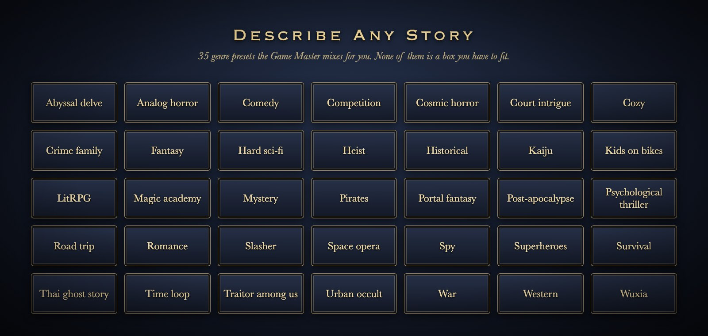
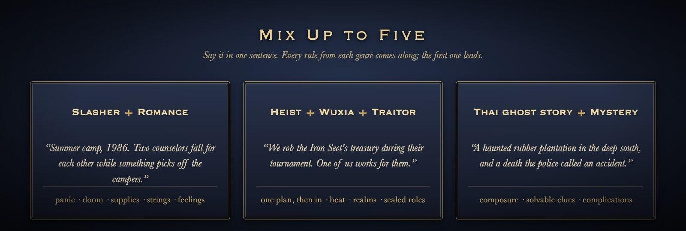

<div align="center">
  

  <h3>Describe any story. Your AI Game Master builds it, runs it, and plays everyone in it.</h3>
  <p>Dungeons &amp; Everything is a Game Master skill for any AI coding agent, running on the <b>Unrolled Engine</b>:<br>a murder mystery, a heist, a slasher night, a cozy village or a D&amp;D dungeon, each on rules made for it,<br>and a world that keeps moving when the party isn't looking.</p>

  <p>
    <a href="https://github.com/noxhsxrk/dungeons-and-everything/actions/workflows/tests.yml"></a>
    <a href="https://github.com/noxhsxrk/dungeons-and-everything/releases"></a>
    <a href="LICENSE"></a>
    
  </p>

  <p>
    <a href="#quick-start">Quick start</a> ·
    <a href="#any-genre">Any genre</a> ·
    <a href="#mix-genres">Mix genres</a> ·
    <a href="#three-ways-to-play">Three ways to play</a> ·
    <a href="#what-the-engine-does">What the engine does</a> ·
    <a href="#play-together">Play together</a> ·
    <a href="#install">Install</a> ·
    <a href="README.th.md">ภาษาไทย</a>
  </p>
</div>

---

> **2.0.0-alpha.** This is the first release that plays any genre. The 5e side is unchanged from 1.8.6; the new rules are young and their numbers will move. If you want only the stable 5e engine, `git checkout v1.8.6` after cloning.

## Quick start

```bash
git clone https://github.com/noxhsxrk/dungeons-and-everything.git ~/dungeons-and-everything
cd ~/dungeons-and-everything && python3 install.py     # sets up every AI agent it finds
```

Then, in your agent (Claude Code, Codex, Gemini CLI, Antigravity, opencode, Copilot, Cursor …):

```
/dne new hollow-9          # describe the story you want; the GM suggests how to run it
/dne character new         # make a character for that world
/dne load hollow-9         # play: type what your character does
```

Python 3.10+. For the TV and phone display: `pip3 install flask flask-cors numpy cryptography`.


<sub>Five worlds built and played while testing: <b>Neon Krung</b> (Bangkok 2077) · <b>Himmapan</b> (mythic Ayutthaya) · <b>Iron Hymn</b> (Weird West, 1881) · <b>Cedar Falls</b> (1994, no powers at all) · <b>Perihelion</b> (hard sci-fi on the 2024 rules).</sub>

## Any genre

At `/dne new` you just describe the story you want, in your own words: *"a murder in a monsoon fishing village, and something in the fog"*, *"we're stuck in the same school day and one of us is lying"*, *"a quiet year running a noodle shop"*. The GM reads it and pitches back how it will run it, in plain words, and you change what you like. There is no menu to pick from.

Behind that pitch the engine has 35 genre presets, each a bundle of small rules rather than a box your story has to fit: mystery, heist, war, competition, psychological thriller, spy, court intrigue, crime family, survival; cosmic horror, Thai ghost story, slasher, analog horror, romance, cozy, comedy, kids on bikes; fantasy, portal fantasy, magic academy, abyssal delve, urban occult, hard sci-fi, space opera, post-apocalypse, superheroes, western, pirates, kaiju and giant robots, wuxia, LitRPG, historical; time loop, road trip and traitor among us. A story none of them fits runs on plain Braid with only the rules it needs (23 modules to pick from).



**A different story every time.** The story generator rolls a skeleton (the crime, the victim, who did it, why, how, the twist, the red herring) from each genre's own lists and remembers past campaigns, so the hundredth murder is not the first one again. A mystery is checked before play: every place reachable, every conclusion backed by at least three clues in at least two places, and still solvable in 95% of 1000 trials that hide a third of the clues.

**[The full guide: how to prompt for every genre, with examples →](ANY_GENRE.md)**

## Mix genres



The best stories are rarely one thing. Describe two or three at once and the GM mixes up to five presets, every rule included:

| Say | You get |
|---|---|
| *"Summer camp, 1986. Two counselors fall for each other while something picks off the campers."* | slasher + romance: panic, doom and dwindling supplies, plus strings and feelings between the leads |
| *"We rob the Iron Sect's treasury during their tournament. One of us secretly works for them."* | heist + wuxia + traitor: one plan then straight in, heat, cultivation realms, and secret roles under a seal |
| *"A quiet village where the lantern festival repeats every day, and every day someone is poisoned."* | mystery + time loop + cozy: clues that stay solvable, the loop, seasons and neighbours |
| *"A mining crew finds something in the ice. The air is running out, and so are our minds."* | cosmic horror + hard sci-fi: composure, clues, usage dice for air and parts |

The first genre leads the voice, pace and difficulty, so *slasher + romance* is a horror story with a love story inside, and *romance + slasher* is the other way round. Where two genres disagree, the GM asks you instead of choosing; two plot-driving stories (a heist and a murder) ask which one drives. More example mixes and how to write them: [Mixing genres](ANY_GENRE.md#mixing-genres).

## Three ways to play

Each campaign picks its rules once, at `/dne new`.

| | **Braid** (default for a new world) | **Story mode** | **5e** |
|---|---|---|---|
| The roll | 2d6 + an approach | the oracle: *likely*, *50/50*, *unlikely* | d20 + modifier against a DC |
| The sheet | five approaches, labels, a drive and a flaw, harm 0–4, stress 0–6, bonds | the Braid sheet; an approach only sets the odds | full 5e: ability scores, class, level, HP, AC, spell slots |
| Enemies | a threat 1–5 and the moves it makes | as in Braid | stat blocks from the SRD or your World Kit |
| Best for | any genre, short or long | tables that never want to see dice | dungeons, tactical fights, D&D campaigns |

**Braid** is our own ruleset: one roll for every genre. You roll 2d6 plus one of five approaches (Force, Finesse, Wits, Heart, Grit) and read a five-step ladder:

| 3 or less | 4–6 | 7–9 | 10–11 | 12+ |
|---|---|---|---|---|
| critical failure | failure | success at a cost | success | critical success |

The cost is named before the dice, so a 7–9 is a choice, not a surprise. Push for +1 at the price of stress, get +1 help from someone you share a bond with, spend a token to move a result one step up. Experience comes from playing your drive and your flaw, from failing and from milestones. The rules are in [`SKILL-core.md`](skills/dne/SKILL-core.md); every number is in [`data/braid.json`](skills/dne/data/braid.json).

**5e** campaigns play exactly as before: say "D&D" or "5e" at `/dne new`. Existing saves are stamped `**System:** d20` once, with a backup, the next time they load.

Braid borrows ideas from many games (the five-step ladder, push and help, usage dice, clocks, progress tracks, the oracle) and writes all of them in its own words; [`THIRD_PARTY.md`](THIRD_PARTY.md) lists every outside source we use. Braid is not compatible with, or endorsed by, any other game.

## What the engine does

An AI that improvises everything forgets the rules, the prices and who owed whom by the third session. The Unrolled Engine keeps all of that in scripts the Game Master has to go through, so the AI tells the story and the engine keeps it honest. The name is a nod to the big game engines: a world that hasn't been rolled yet, unrolled one day at a time.

### 1. Rules that are computed, not guessed

- **Every roll goes through one resolver**, Braid, story or 5e, with the math shown. A player can roll their own dice and type the result.
- **Tracks, clocks, pools and conditions are engine records**: stress, heat, doom, a cultivation stage or a 5e spell slot changes only through an engine action, and shows on the display.
- **Every turn can be rewound** (`/dne undo`), files and all, and a late message from a rewound turn can't change the present.
- **5e in full:** attacks, damage, conditions, rests, XP and money from scripts; 2014 or 2024 rules (SRD 5.1 or 5.2) per campaign; enemies that see only what is in their line of sight, take cover, retreat when broken and spend only what they have; a fight that ends when its point is settled, not when the last hit point is gone.

### 2. A world that lives on its own

Braid campaigns always run on it; 5e campaigns can switch it on at `/dne new` (or later, with a backup first).

- **One clock for everything.** In-world time passes only through the engine. What was set in motion arrives when it is due, a rest or a journey stops for the players to decide when something comes up, and a month skipped at once ends in exactly the same world as thirty single days.
- **Turns that survive.** Input is stored once, a roll is made once, a message is shown once. A crash or a compacted chat picks up where it stopped.
- **Roads, caravans and markets.** Who holds a bridge, what it costs to cross, whether the flour arrives. Prices state their reason; the last sack goes to one buyer.
- **Nobody knows what they weren't told.** News travels by rider, rumour or radio and can be intercepted. NPCs keep appointments; factions plan from what they have actually heard.
- **Communities that keep themselves alive.** Machines wear and fail, whoever has the skill takes over, a shortage brings a rota, and what the trouble made stays.
- **New worlds ready on turn one.** `/dne new` collects the whole world into one seed that the engine checks (every problem comes back with where to fix it) and builds in one go.

The contract every engine module keeps is in [`world_db.py`](skills/dne/scripts/world_db.py); a playtest script is in [`docs/world-engine-playtest.md`](docs/world-engine-playtest.md).

### 3. A rulebook for any world (the World Kit)

Describe the world in a line or a full setting bible:

> *AD 2289. EDEN, the AI that ran the planet, decided humanity could no longer be trusted with its own survival. The survivors live underground. The players belong to Hollow-9, a colony of 600. One night, the oxygen plant fails.*


The engine turns that into the world's own rulebook, `worldkit.json`, and checks it before play. In Braid it holds the world's labels, gear and threats. In 5e it holds full origins, classes on a 5e chassis, re-skinned spells and items, threats with CR-correct XP, and the world's own words (spell → protocol, long rest → lockdown):

| The world gets | In the EDEN example |
|---|---|
| Origins and classes *(5e)* / labels *(Braid)* | Tunnel-Born; Soldier, Mechanic, Medic |
| Powers and gear | *Static Burst*; Rail Pistol |
| Threats | Watcher, Reaper, Titan |
| Language | spell → protocol, Arcana → Systems |

Say **"classic fantasy"** to play on the bundled 5e SRD. Example kit: [`worldkit.example.json`](skills/dne/templates/worldkit.example.json).

### 4. Table rules for 5e, switch by switch


A 5e table can still mix in rules from other games: success at a cost and degrees of success, playbook moves and bonds, flaws, reaction rolls and tech levels, hero points and victory points for chases and heists, faction turns, monster morale and place tags. Each one is rebuilt on the d20 core and switched per campaign. Reference: [`SKILL-table-rules.md`](skills/dne/SKILL-table-rules.md).

### 5. A Game Master that is held to account

- **NPCs are real records** the moment they appear: stats, aliases, voice, history. They grow while the party is away.
- **A note with every player action** tells the GM what is due (a save, an XP award, a clock out of step) and which rules apply right now. A Braid GM is never pointed at a 5e script.
- **A style guard** catches repeated phrases, feelings narrated for the players and talking past the moment to stop; a **spark** every few turns offers an idea the GM may drop.
- **Your table's limits.** Content `standard`, `18` or `20`; romance `off`, `fade` or `open` (adults only); lines and veils; anyone can type `x` to skip a moment. The Table Settings page (`setup.html`) sets the dials with ticks instead of typing.

## Play together


One computer runs the Game Master; everyone else needs a phone.

```bash
bash skills/dne/display/start-display.sh --lan      # same room: phones on your Wi-Fi
bash skills/dne/display/start-display.sh --ngrok    # friends anywhere, over HTTPS
```

The story types itself out on the TV with dice, a party sidebar, handouts, progress clocks and optional narration in a voice per NPC. Each player opens `…/?char=<their character>` to see their sheet, roll and send actions; secret checks go to that phone only. With **autorun**, the Game Master picks up each action and plays the next turn on its own. More: [`display/README.md`](skills/dne/display/README.md).

## Install

Works with **any AI agent that can read files and run shell commands**. `python3 install.py` sets up every agent it finds; `--list` shows what is supported, `python3 install.py codex gemini` picks agents, `--uninstall` removes it. The skill is linked, not copied, so `git pull` updates every agent at once.

<details>
<summary>What <code>install.py</code> does per agent</summary>

| Agent | What it does |
|---|---|
| Claude Code, Codex, Gemini CLI, Antigravity, opencode, Copilot CLI, Crush, Droid | links `skills/dne` into the agent's skills folder: type **`/dne`** |
| Cursor, Kiro, Cline, Continue, Kilo Code | writes a small rules file that points the agent at the skill |
| Amp, Qwen Code, Goose, Kimi | adds one marked block to the agent's rules file (removed cleanly by `--uninstall`) |
| Aider | run `aider --read ~/dungeons-and-everything/skills/dne/SKILL.md` |
| Anything else | tell your agent: *"Read `<repo>/skills/dne/SKILL.md` and follow it"* |

**Claude Code plugin** (alternative): `/plugin marketplace add noxhsxrk/dungeons-and-everything`, then `/plugin install dne@dungeons-and-everything`, and invoke it as **`/dne:dne`**.

Only conveniences differ between agents: without a question tool you get numbered options in chat; without background tasks there is no phone **autorun** loop; without subagents the Game Master plays companions itself.
</details>

**Updating:** `git pull` in the repo, or `/dne update` in a game. Campaigns are never touched; an older world is offered an upgrade the next time you load it.
**Your games** are plain markdown and JSON in `~/.dne/`; move them with `/dne path <dir>` or `DNE_CAMPAIGN_ROOT`.
**Importing:** `/dne import <name> module.pdf` runs a published adventure (PDF, DOCX, markdown or text; PDFs need `pip3 install pymupdf`).

<details>
<summary>All commands</summary>

| Campaign | |
|---|---|
| `/dne new <name>` | Describe a world and build a new campaign |
| `/dne load <name>` · `/dne list` | Continue a campaign · list your campaigns |
| `/dne save` · `/dne end` · `/dne abandon` | Save progress · end the session with a recap · quit without saving |
| `/dne import <name> <file>` | Turn a written adventure into a campaign |
| `/dne world` · `/dne world kit` | World lore · the World Kit |
| `/dne recap` · `/dne quests` | Last session in a few sentences · open quests and threads |
| `/dne arc status \| advance \| revise \| new` | Inspect and steer the story arc |
| `/dne undo` | Rewind the last turn |

| Characters & party | |
|---|---|
| `/dne character new` · `/dne character sheet [name]` | Build a character · show a sheet |
| `/dne character import <name>` | Bring a character from another campaign, translated into the new world |
| `/dne level up [name]` | Level up, with every choice the level grants |
| `/dne rest short` · `/dne rest long` | Rests, with exact hit dice and slot recovery |
| `/dne npc <name>` · `/dne npc attitude <name> <level>` | Talk to or create an NPC · shift their attitude |
| `/dne companion add \| leave \| mode \| status` | NPCs who travel with the party and think for themselves |

| Table | |
|---|---|
| `/dne display start \| stop \| status` | The TV display and phone controllers |
| `/dne autorun on \| off` | Players act from their phones; the Game Master answers automatically |
| `/dne tutor on \| off` | Gentle rules hints for new players |
| `/dne path [<dir> \| reset]` · `/dne update [--check]` | Move your data · update the skill |
</details>

## Contributing

```bash
python3 -m venv .venv && .venv/bin/pip install pytest flask flask-cors pyyaml
.venv/bin/python -m pytest tests/ -q
```

The Game Master is [`SKILL.md`](skills/dne/SKILL.md) (core rules and the 5e Game Master), [`SKILL-core.md`](skills/dne/SKILL-core.md) (Braid), [`SKILL-commands.md`](skills/dne/SKILL-commands.md) (every `/dne` procedure) and [`SKILL-scripts.md`](skills/dne/SKILL-scripts.md) (script reference); the engine is in [`skills/dne/scripts/`](skills/dne/scripts/), the display in [`skills/dne/display/`](skills/dne/display/). Read [CONTRIBUTING.md](CONTRIBUTING.md) before a pull request, and [CHANGELOG.md](CHANGELOG.md) for what changed.

## Support

- **Questions, bugs, ideas:** [open an issue](https://github.com/noxhsxrk/dungeons-and-everything/issues).
- **Security:** see [SECURITY.md](SECURITY.md); please don't report vulnerabilities in a public issue.
- **Releases:** [what's new](https://github.com/noxhsxrk/dungeons-and-everything/releases).

## License

[AGPL-3.0-or-later](LICENSE) · see [NOTICE](NOTICE). Not affiliated with or endorsed by Wizards of the Coast. 5e rules content comes from the System Reference Document under CC BY 4.0.
