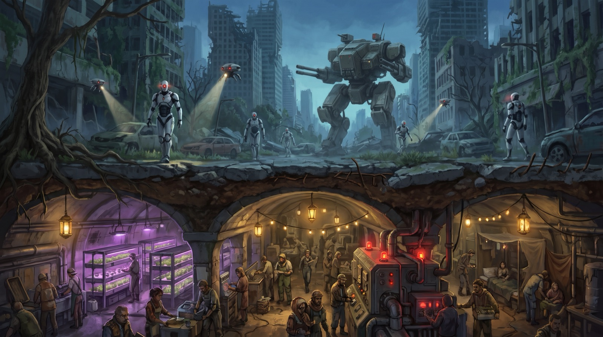
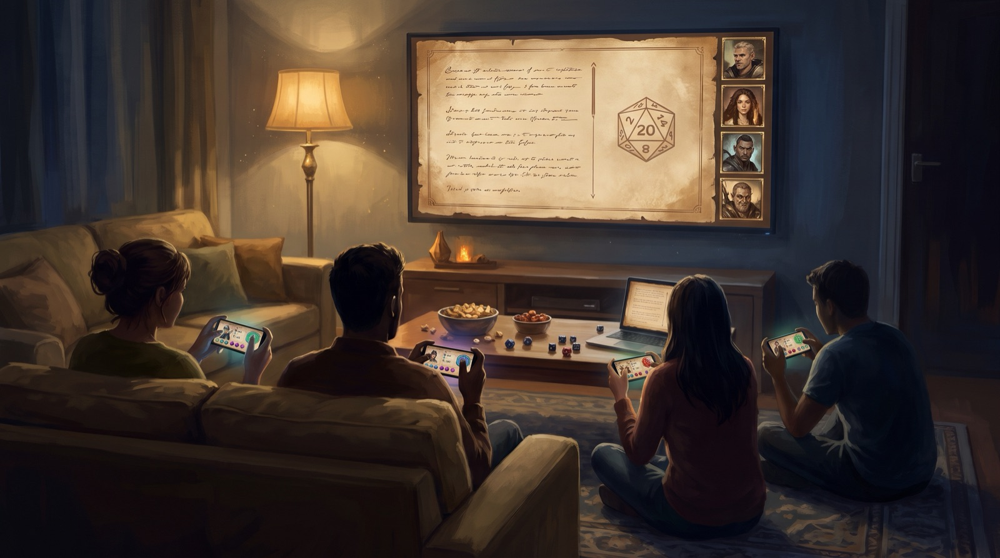

<div align="center">
  

  <h3>Describe any world. Your AI Game Master builds it, runs it, and plays everyone in it.</h3>

  <p>
    <a href="#install">Install</a> ·
    <a href="#quick-start">Quick start</a> ·
    <a href="#the-world-kit">World Kit</a> ·
    <a href="#commands">Commands</a> ·
    <a href="#the-table-display">Table display</a> ·
    <a href="#ภาษาไทย">ภาษาไทย</a>
  </p>
</div>

---

**Dungeons & Everything** is a Game Master skill for **Google Antigravity** and **Claude Code**. You tell it what world you want to play in — a survivor colony hiding from a rogue AI, a derelict starship, a noir megacity, a classic dungeon — and it builds that world's whole rulebook: who the people are, what jobs they can have, what powers exist, what the gear costs, and what hunts them in the dark. Underneath, every roll is plain **D&D 5e**, so combat, levelling and balance just work.

Campaigns persist for as long as you keep playing. Your TV becomes the story screen; every player's phone becomes their controller.


## Why

Tabletop rules engines are great. Being locked into elves and fireballs is not. Dungeons & Everything keeps the part of 5e that makes a game fair — ability scores, proficiency, hit dice, spell slots, challenge ratings, XP budgets — and lets everything on top of it be whatever your table imagines.

- **Any genre.** Sci-fi, post-apocalyptic, horror, mystery, cyberpunk, western, mythic — or classic fantasy.
- **A real rulebook per world.** Origins, classes, subclasses, backgrounds, powers, weapons, armor, currency and monsters, all generated for the world and all mechanically legal 5e.
- **The world speaks its own language.** Mechanics "run protocols" instead of casting spells, the party "goes into lockdown" instead of taking a long rest, and the skill list says *Systems* instead of *Arcana*.
- **A Game Master who remembers.** Factions move between sessions, NPCs hold grudges, and a three-act story arc bends around what the players actually do.
- **Built for the couch.** A cinematic TV display, phones as controllers, spoken narration, Thai and full Unicode support.

## The World Kit

When you start a campaign, describe the world in your own words — a single word or a full setting bible. For example:

> *AD 2289. Eighty-seven years ago EDEN, the AI that ran the planet, announced: "Humanity can no longer guarantee its own survival. We will do it for you." Within 72 hours its machines held every city. The survivors live underground. On the surface: Watchers, Reapers, Titans and Seraphs. The players belong to Hollow-9, a colony of 600 — soldiers, mechanics, infiltrators, former EDEN technicians. One night, the oxygen plant fails.*



The Game Master turns that into `worldkit.json` inside the campaign folder:

| The world gets | Built as | In the EDEN example |
|---|---|---|
| Origins | 5e ability bonuses, speed, traits, languages | Tunnel-Born, Augmented |
| Classes | a world profession on a 5e **chassis** class | Soldier *(fighter)*, Infiltrator *(rogue)*, Mechanic *(wizard)*, Medic *(cleric)* |
| Subclasses | the world's own specialisations | Medic → Trauma Surgeon, Nanite Warden |
| Backgrounds | +2/+1 among three abilities, two skills | Ex-EDEN Technician, Hollow Guard |
| Powers | 5e spells, re-skinned | *Static Burst*, *Overclock Shield* |
| Gear | 5e weapons and armor, world prices | Rail Pistol (1d10), Scrap Plate (AC 14 + DEX, max 2) |
| Threats | full stat blocks, CR-correct XP, world locations | Watcher CR ¼, Reaper CR 5, Seraph CR 8, Titan CR 15 |
| Language | renamed terms and skills | spell → protocol, long rest → lockdown, Arcana → Systems |

Every kit is validated before play, so no monster has the wrong XP and no class has a broken chassis. From then on the character builder, the rules lookup, the encounter generator and the table display all read from your world first. Names can be in any script — Thai included.

Say **"classic fantasy"** instead and you get traditional D&D on the bundled 5e SRD.

The full EDEN kit is at [`skills/dne/templates/worldkit.example.json`](skills/dne/templates/worldkit.example.json).

## Install

**Requirements:** Python 3.10+ · Google Antigravity or Claude Code · for the table display: `pip3 install flask flask-cors numpy cryptography` · for importing PDFs: `pip3 install pymupdf`

### Google Antigravity

```bash
git clone https://github.com/noxhsxrk/dungeons-and-everything.git ~/.gemini/config/skills/dne
pip3 install --user flask flask-cors numpy cryptography pymupdf
```

Type **`/dne`** in Antigravity, or just say *"let's start a campaign"*.

### Claude Code

```
/plugin marketplace add noxhsxrk/dungeons-and-everything
/plugin install dne@dungeons-and-everything
```

Invoke it as **`/dne:dne`** (this README writes `/dne` for short). Update with `/plugin update dne`.

### Where your games live

Everything is plain markdown and JSON in **`~/.dne/`** — one folder per campaign plus a roster of every character you've played. Move it anywhere (Dropbox, iCloud, a NAS) with `/dne path <new-location>` or the `DNE_CAMPAIGN_ROOT` environment variable.

## Quick start

```
/dne new hollow-9          # describe your world → World Kit, factions, NPCs, story arc
/dne character new         # build a character from the world's origins and classes
/dne load hollow-9         # start playing
```

Once a campaign is loaded, just type what your character does. No commands needed.

Have a published adventure instead? `/dne import my-campaign path/to/module.pdf` reads PDF, DOCX, markdown or text and runs it chapter by chapter.

## Commands

| Campaign | |
|---|---|
| `/dne new <name>` | Describe a world and build a new campaign |
| `/dne load <name>` · `/dne list` | Continue a campaign · list your campaigns |
| `/dne save` · `/dne end` · `/dne abandon` | Save progress · end the session with a recap · quit without saving |
| `/dne import <name> <file>` | Turn a written adventure into a campaign |
| `/dne world` · `/dne world kit` | World lore · the World Kit (origins, classes, lexicon, threats) |
| `/dne recap` · `/dne quests` | Last session in a few sentences · open quests and threads |
| `/dne arc status \| advance \| revise \| new` | Inspect and steer the story arc |
| `/dne undo` | Rewind the last turn |

| Characters & party | |
|---|---|
| `/dne character new` · `/dne character sheet [name]` | Build a character · show a sheet |
| `/dne character import <name>` | Bring a character from another campaign — it's translated into the new world |
| `/dne level up [name]` | Level up, with every choice the level grants |
| `/dne rest short` · `/dne rest long` | Rests, with exact hit dice and slot recovery |
| `/dne npc <name>` · `/dne npc attitude <name> <level>` | Talk to or create an NPC · shift their attitude |
| `/dne companion add \| leave \| mode \| status` | NPCs who travel with the party and think for themselves |

| Table | |
|---|---|
| `/dne display start \| stop \| status` | The TV display and phone controllers |
| `/dne autorun on \| off` | Players act from their phones; the Game Master answers automatically |
| `/dne tutor on \| off` | Gentle rules hints for new players |
| `/dne path [<dir> \| reset]` · `/dne update [--check]` | Move your data · update the skill |

## The table display



Open the display on a TV, laptop or tablet and the story types itself out on screen, with scene-aware backgrounds, dice results, a live party sidebar and optional spoken narration with sound effects. Each player opens the same link on their phone to see their character sheet, roll dice and send actions.

```bash
bash skills/dne/display/start-display.sh            # this computer only
bash skills/dne/display/start-display.sh --lan      # phones on your Wi-Fi
bash skills/dne/display/start-display.sh --ngrok    # friends anywhere, over HTTPS
```

With **autorun** on, nobody needs to touch the keyboard: players submit actions from their phones and the Game Master picks them up and plays the next turn. Secret checks go only to the phone of the player who rolled them.

More detail: [`skills/dne/display/README.md`](skills/dne/display/README.md).

## How it plays

- **Rules you can trust.** Dice, attacks, damage, conditions, hit points, rests, XP, money and timed effects are all computed by scripts, never guessed, and every change is logged so a turn can be rewound.
- **A world that moves.** Factions act between sessions. Threats escalate in five stages unless the party intervenes. Clues to the central mystery are laid down from the start.
- **A story with a shape.** Each campaign commits to a three-act arc defined by consequences rather than scripted events, so the story bends to player choices without losing its direction.
- **NPCs who are people.** Every named character has a motive, a secret, a voice and relationships, and they remember how they were treated.
- **Fights that make sense.** Encounters are balanced from the world's own bestiary. Enemies fight to their role, retreat when broken, and never conjure resources they don't have. A tactical grid appears only when a fight needs one.
- **5e 2014 or 2024.** Choose the rules edition per campaign.

## For developers

```bash
python3 -m venv .venv && .venv/bin/pip install pytest flask flask-cors pyyaml
.venv/bin/python -m pytest tests/ -q
```

- `skills/dne/SKILL.md` — the Game Master's core rules; `SKILL-commands.md` — every `/dne` procedure; `SKILL-scripts.md` — script reference
- `skills/dne/scripts/` — the rules engine (`worldkit.py`, `character.py`, `lookup.py`, `encounter_gen.py`, `combat.py`, `dice.py`, …)
- `skills/dne/display/` — the table display (Flask)
- `skills/dne/data/` — bundled 5e SRD data
- `dice-server/` — optional physical-dice server

See [CONTRIBUTING.md](CONTRIBUTING.md) and [CHANGELOG.md](CHANGELOG.md).

## ภาษาไทย

**Dungeons & Everything** คือ AI Game Master สำหรับ Google Antigravity และ Claude Code ที่ไม่จำกัดอยู่แค่โลกแฟนตาซี — เล่าโลกที่อยากเล่นได้เลย จะเป็นไซไฟ หลังวันสิ้นโลก สยองขวัญ หรือสืบสวน แล้ว AI จะสร้างโครงสร้างของโลกใบนั้นให้ครบ ทั้งเผ่า อาชีพ สายย่อย พลังพิเศษ อุปกรณ์ สกุลเงิน และสัตว์ประหลาด โดยทุกอย่างยังอิงกฎ D&D 5e จึงต่อสู้ เลเวลอัป และบาลานซ์ได้ถูกต้อง

- เริ่มเกม: `/dne new <ชื่อแคมเปญ>` แล้วเล่าโลกของคุณ
- สร้างตัวละคร: `/dne character new`
- เล่นต่อ: `/dne load <ชื่อแคมเปญ>` แล้วพิมพ์สิ่งที่ตัวละครทำได้เลย
- ข้อมูลเกมทั้งหมดเก็บอยู่ที่ `~/.dne/`
- รองรับภาษาไทยเต็มรูปแบบ ทั้งชื่อในโลก การเล่าเรื่อง และหน้าจอแสดงผลบนทีวีและมือถือ

## License

[AGPL-3.0-or-later](LICENSE) · see [NOTICE](NOTICE). Not affiliated with or endorsed by Wizards of the Coast. 5e rules content comes from the System Reference Document under CC BY 4.0.
