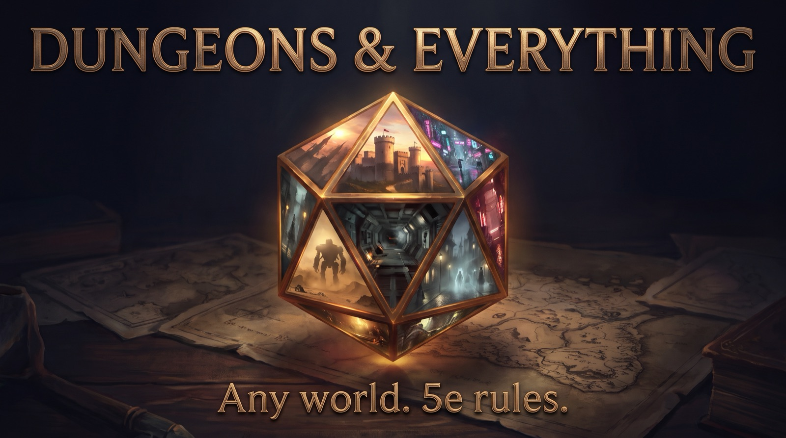
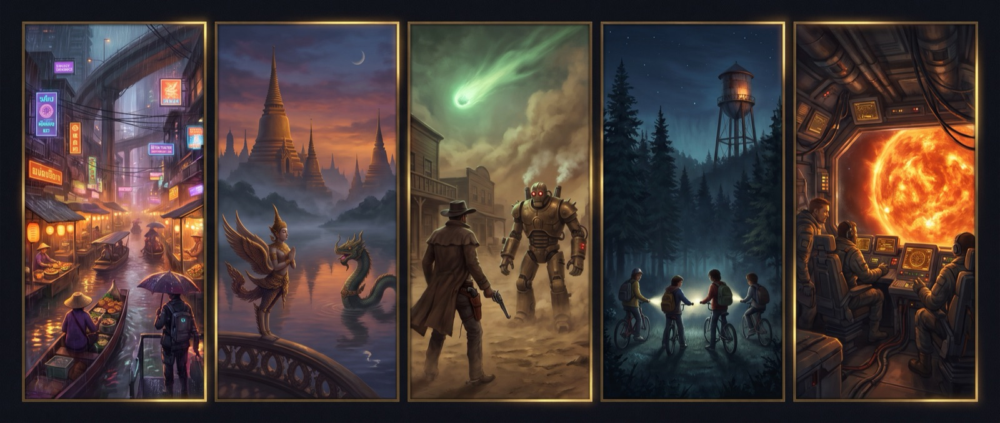
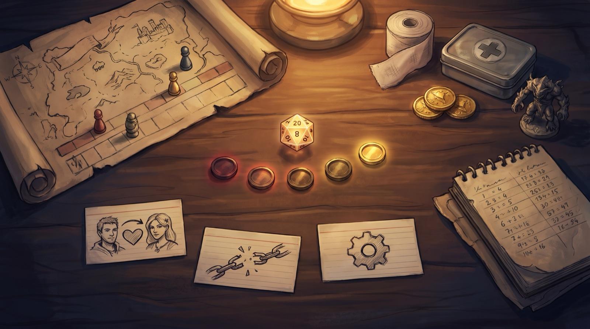

<div align="center">
  

  <h3>Describe any world. Your AI Game Master builds it, runs it, and plays everyone in it.</h3>
  <p>A tabletop Game Master skill for any AI coding agent, on the <b>Unrolled Engine</b>: a d20 engine with a 5e SRD core.</p>

  <p>
    <a href="https://github.com/noxhsxrk/dungeons-and-everything/actions/workflows/tests.yml"></a>
    <a href="https://github.com/noxhsxrk/dungeons-and-everything/releases/latest"></a>
    <a href="LICENSE"></a>
    
    
  </p>

  <p>
    <a href="#quick-start">Quick start</a> ·
    <a href="#highlights">Highlights</a> ·
    <a href="#the-world-kit">World Kit</a> ·
    <a href="#a-world-that-lives-on-its-own">Living world</a> ·
    <a href="#play-together">Play together</a> ·
    <a href="#install">Install</a> ·
    <a href="#ภาษาไทย">ภาษาไทย</a>
  </p>
</div>

---

## Quick start

```bash
git clone https://github.com/noxhsxrk/dungeons-and-everything.git ~/dungeons-and-everything
cd ~/dungeons-and-everything && python3 install.py     # sets up every AI agent it finds
```

Then, in your agent (Claude Code, Codex, Gemini CLI, Antigravity, opencode, Copilot, Cursor …):

```
/dne new hollow-9          # describe your world: you get its rulebook, factions, NPCs and a story arc
/dne character new         # build a character from that world's origins and classes
/dne load hollow-9         # play: just type what your character does
```

Requirements: Python 3.10+. For the TV and phone display: `pip3 install flask flask-cors numpy cryptography`.

## Highlights

- **Any genre, a real rulebook per world.** Sci-fi, post-apocalyptic, horror, western, mythic or classic fantasy: origins, classes, powers, gear, currency and monsters are generated for *your* world and checked against the 5e SRD so the numbers hold.
- **Rules you can trust.** Dice, damage, conditions, rests, XP and money are computed by scripts, never guessed; every turn can be rewound with `/dne undo`.
- **A world that lives on its own.** Time passes on one clock; markets run out, caravans find the road shut, news travels at the speed of a rider, and a community keeps itself alive (or doesn't) while the party is away.
- **A Game Master who remembers.** NPCs with motives, secrets and grudges; factions that move every in-world week; a three-act arc that bends around what the players actually do.
- **The best ideas from other tables.** Success at a cost, bonds and playbook moves (PbtA), Hero and Victory Points (PF2e), faction turns and monster morale (WWN), each switchable per campaign.
- **Built for the couch.** The story on your TV, a controller on every phone, spoken narration, full Thai and Unicode.
- **Any agent, no lock-in.** Plain markdown instructions plus Python scripts; your campaigns are markdown and JSON files you own.



<sub>Five worlds built and played while testing: <b>Neon Krung</b> (Bangkok 2077) · <b>Himmapan</b> (mythic Ayutthaya) · <b>Iron Hymn</b> (Weird West, 1881) · <b>Cedar Falls</b> (1994, no powers at all) · <b>Perihelion</b> (hard sci-fi on the 2024 rules).</sub>

## Why

Tabletop rules engines are great. Being locked into elves and fireballs is not. And an AI that improvises everything forgets the rules, the prices and who owed whom by the third session.

DnE keeps the part of the 5e SRD that makes a game fair (ability scores, proficiency, hit dice, challenge ratings, XP budgets) in scripts the Game Master must use, and lets everything on top of it be whatever your table imagines. The name of the engine is a nod to the big game engines: the **Unrolled Engine** runs a world that hasn't been rolled yet, and unrolls it one day at a time, with or without the party.

## The World Kit

Describe the world in your own words, a single line or a full setting bible:

> *AD 2289. Eighty-seven years ago EDEN, the AI that ran the planet, announced: "Humanity can no longer guarantee its own survival. We will do it for you." The survivors live underground. The players belong to Hollow-9, a colony of 600. One night, the oxygen plant fails.*


The Game Master turns that into the world's rulebook, `worldkit.json`:

| The world gets | Built as | In the EDEN example |
|---|---|---|
| Origins and classes | 5e traits; a world profession on a 5e **chassis** class | Tunnel-Born; Soldier *(fighter)*, Mechanic *(wizard)*, Medic *(cleric)* |
| Subclasses and backgrounds | the world's own specialisations | Medic → Trauma Surgeon; Ex-EDEN Technician |
| Powers and gear | 5e spells and items, re-skinned and priced | *Static Burst*; Rail Pistol (1d10) |
| Threats | full stat blocks, CR-correct XP | Watcher CR ¼, Reaper CR 5, Titan CR 15 |
| Moves, flaws, tech level | playbook moves, quirks, rarity | *Hold the Hatch*; *Oxygen Debt*; tech level 10 |
| Language | renamed terms and skills | spell → protocol, long rest → lockdown, Arcana → Systems |



Every kit is validated before play. Say **"classic fantasy"** instead to play on the bundled 5e SRD. The full EDEN kit: [`worldkit.example.json`](skills/dne/templates/worldkit.example.json). The optional table rules: [`SKILL-table-rules.md`](skills/dne/SKILL-table-rules.md).

## A world that lives on its own

Opt in per campaign (answer *yes* to "should the world live on its own?" at `/dne new`, or `world_migrate.py -c <campaign> enable` for an existing one, which backs it up first). Then:

- **Turns that survive.** Input is stored once, a roll is made once, a message is shown once; a crash or a compacted chat resumes where it stopped.
- **One clock for everything.** Consequences are queued and arrive when due; a rest or a journey stops for the players to decide when something comes up. A month skipped at once ends in the same world as thirty single days.
- **Work that depends on other work.** Each world declares its own kinds of work (a forge that needs coal, a ferry that can't land in a flood): tasks wait for what they lack, reserve their materials, and get cancelled when the world changes under them.
- **A community that keeps itself alive.** Machines wear and fail, whoever is there with the skill takes over the repair, the council rules, shortages bring rotas and pacts with the neighbours, and what the trouble made stays. Each day writes who did what, why they could, and what it left.
- **Nobody knows what they were not told.** News travels by rider or radio and can be intercepted; factions act on what they have actually heard.

It is experimental and off by default. Details: [the playtest script](docs/world-engine-playtest.md) and the contract in [`world_db.py`](skills/dne/scripts/world_db.py).

## Play together


One computer runs the Game Master; everyone else just needs a phone.

```bash
bash skills/dne/display/start-display.sh --lan      # same room: phones on your Wi-Fi
bash skills/dne/display/start-display.sh --ngrok    # friends anywhere, over HTTPS
```

The story types itself out on the TV with dice results, a party sidebar, handouts and optional spoken narration. Each player opens `…/?char=<their character>` on their phone to see their sheet, roll their own dice and send actions; secret checks go to that phone only. With **autorun** on, nobody touches the keyboard: the Game Master picks up each action and plays the next turn. More: [`display/README.md`](skills/dne/display/README.md).

## Install

Works with **any AI agent that can read files and run shell commands**. `python3 install.py` sets up every agent it finds; `python3 install.py --list` shows what it supports, `python3 install.py codex gemini` picks agents, `--uninstall` removes it. The skill is linked, not copied, so `git pull` updates every agent at once.

<details>
<summary>What <code>install.py</code> does per agent</summary>

| Agent | What it does |
|---|---|
| Claude Code, Codex, Gemini CLI, Antigravity, opencode, Copilot CLI, Crush, Droid | links `skills/dne` into the agent's skills folder: type **`/dne`** |
| Cursor, Kiro, Cline, Continue, Kilo Code | writes a small rules file that points the agent at the skill |
| Amp, Qwen Code, Goose, Kimi | adds one marked block to the agent's rules file (removed cleanly by `--uninstall`) |
| Aider | run `aider --read ~/dungeons-and-everything/skills/dne/SKILL.md` |
| Anything else | tell your agent: *"Read `<repo>/skills/dne/SKILL.md` and follow it"* |

**Claude Code plugin** (alternative): `/plugin marketplace add noxhsxrk/dungeons-and-everything`, then `/plugin install dne@dungeons-and-everything`, and invoke it as **`/dne:dne`**.

Only conveniences differ between agents: without a question tool you get numbered options in chat; without background tasks there is no phone **autorun** loop; without subagents the Game Master plays companions itself.
</details>

**Updating:** `git pull` in the repo, or `/dne update` in a game. Your campaigns are never touched; an older world is offered an upgrade the next time you load it.
**Your games** are plain markdown and JSON in `~/.dne/`; move them anywhere with `/dne path <dir>` or `DNE_CAMPAIGN_ROOT`.
**Importing:** `/dne import <name> module.pdf` runs a published adventure (PDF, DOCX, markdown or text; PDFs need `pip3 install pymupdf`).

<details>
<summary>All commands</summary>

| Campaign | |
|---|---|
| `/dne new <name>` | Describe a world and build a new campaign |
| `/dne load <name>` · `/dne list` | Continue a campaign · list your campaigns |
| `/dne save` · `/dne end` · `/dne abandon` | Save progress · end the session with a recap · quit without saving |
| `/dne import <name> <file>` | Turn a written adventure into a campaign |
| `/dne world` · `/dne world kit` | World lore · the World Kit |
| `/dne recap` · `/dne quests` | Last session in a few sentences · open quests and threads |
| `/dne arc status \| advance \| revise \| new` | Inspect and steer the story arc |
| `/dne undo` | Rewind the last turn |

| Characters & party | |
|---|---|
| `/dne character new` · `/dne character sheet [name]` | Build a character · show a sheet |
| `/dne character import <name>` | Bring a character from another campaign, translated into the new world |
| `/dne level up [name]` | Level up, with every choice the level grants |
| `/dne rest short` · `/dne rest long` | Rests, with exact hit dice and slot recovery |
| `/dne npc <name>` · `/dne npc attitude <name> <level>` | Talk to or create an NPC · shift their attitude |
| `/dne companion add \| leave \| mode \| status` | NPCs who travel with the party and think for themselves |

| Table | |
|---|---|
| `/dne display start \| stop \| status` | The TV display and phone controllers |
| `/dne autorun on \| off` | Players act from their phones; the Game Master answers automatically |
| `/dne tutor on \| off` | Gentle rules hints for new players |
| `/dne path [<dir> \| reset]` · `/dne update [--check]` | Move your data · update the skill |

Content is set per table at `/dne new`: `standard`, `18` or `20`, romance `off` / `fade` / `open` (adult characters only), lines and veils; anyone can type `x` to skip a moment.
</details>

## Contributing

```bash
python3 -m venv .venv && .venv/bin/pip install pytest flask flask-cors pyyaml
.venv/bin/python -m pytest tests/ -q
```

The Game Master is [`skills/dne/SKILL.md`](skills/dne/SKILL.md) (core rules), [`SKILL-commands.md`](skills/dne/SKILL-commands.md) (every `/dne` procedure) and [`SKILL-scripts.md`](skills/dne/SKILL-scripts.md) (script reference); the engine is in [`skills/dne/scripts/`](skills/dne/scripts/), the display in [`skills/dne/display/`](skills/dne/display/). Read [CONTRIBUTING.md](CONTRIBUTING.md) before a pull request, and [CHANGELOG.md](CHANGELOG.md) for what changed.

## Support

- **Questions, bugs, ideas:** [open an issue](https://github.com/noxhsxrk/dungeons-and-everything/issues).
- **Security:** see [SECURITY.md](SECURITY.md); please don't report vulnerabilities in a public issue.
- **Releases:** [what's new](https://github.com/noxhsxrk/dungeons-and-everything/releases).

## ภาษาไทย

**Dungeons & Everything** คือ AI Game Master ที่ใช้ได้กับ AI agent ทุกตัว (Claude Code, Codex, Gemini CLI, Antigravity, opencode, Copilot, Cursor ฯลฯ) และไม่จำกัดอยู่แค่โลกแฟนตาซี เล่าโลกที่อยากเล่นได้เลย จะเป็นไซไฟ หลังวันสิ้นโลก สยองขวัญ หรือสืบสวน แล้ว AI จะสร้างกฎของโลกใบนั้นให้ครบ ทั้งเผ่า อาชีพ พลังพิเศษ อุปกรณ์ สกุลเงิน และสัตว์ประหลาด ทุกอย่างรันบน **Unrolled Engine** เอนจิน d20 ของ DnE ที่มีแกนกฎจาก 5e SRD จึงต่อสู้ เลเวลอัป และบาลานซ์ได้ถูกต้อง

- **ติดตั้ง:** `git clone` repo แล้วรัน `python3 install.py` ตั้งค่าให้ทุก agent ที่เจอในเครื่องในครั้งเดียว
- **เริ่มเกม:** `/dne new <ชื่อแคมเปญ>` แล้วเล่าโลกของคุณ → `/dne character new` → `/dne load <ชื่อแคมเปญ>` แล้วพิมพ์สิ่งที่ตัวละครทำได้เลย
- **โลกที่มีชีวิตของตัวเอง (ทดลอง):** ตอบ "ใช่" ตอนสร้างโลก แล้วเวลาในเกมจะเดินจริง ตลาดของหมดได้ ข่าวเดินทางช้าตามจริง ชุมชนซ่อมเครื่อง แบ่งน้ำ ทำข้อตกลงกับเพื่อนบ้านเองระหว่างที่ปาร์ตี้ไม่อยู่
- **เล่นหลายคน:** เครื่องเดียวรัน GM ผู้เล่นเปิดลิงก์ `?char=<ชื่อตัวละคร>` บนมือถือ อยู่ห้องเดียวกันใช้ `--lan` อยู่คนละที่ใช้ `--ngrok`
- **ภาษาไทยเต็มรูปแบบ:** ชื่อในโลก การเล่าเรื่อง ปฏิทินและเวลา หน้าจอทีวีและมือถือ (ฟอนต์ไทย สระไม่ลอยไม่จม)
- **ระดับเนื้อหา:** `standard`, `18` หรือ `20` และ romance (`off` / `fade` / `open` เฉพาะตัวละครผู้ใหญ่) พร้อม lines/veils และพิมพ์ `x` ข้ามฉากได้ทุกเมื่อ
- **ข้อมูลเกม** เก็บที่ `~/.dne/` อัปเดตด้วย `git pull` หรือ `/dne update` ข้อมูลแคมเปญไม่ถูกแตะ

## License

[AGPL-3.0-or-later](LICENSE) · see [NOTICE](NOTICE). Not affiliated with or endorsed by Wizards of the Coast. 5e rules content comes from the System Reference Document under CC BY 4.0.
