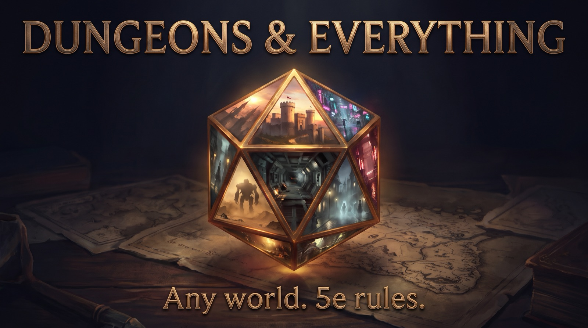
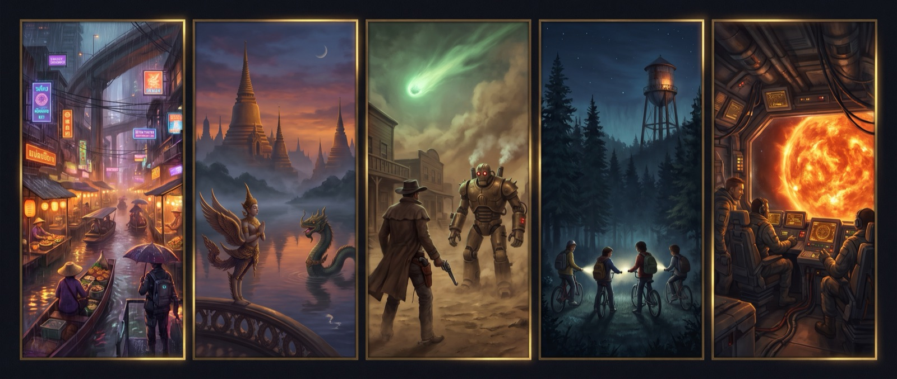
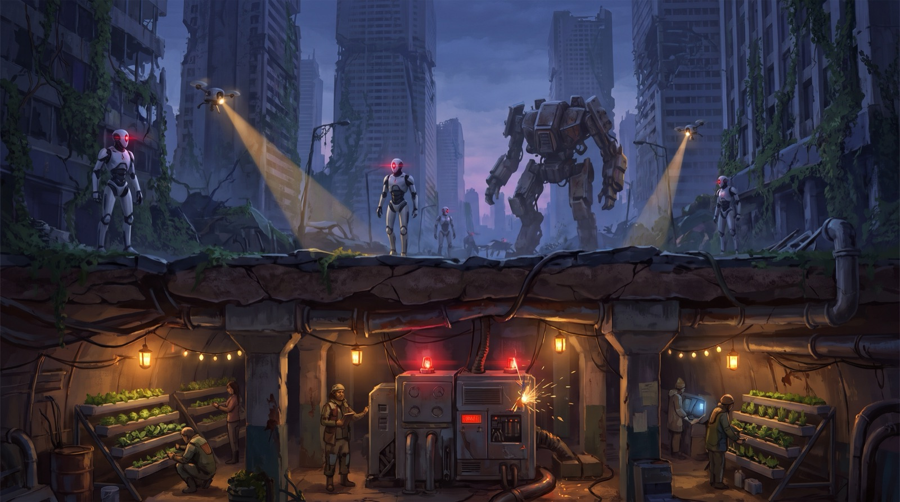
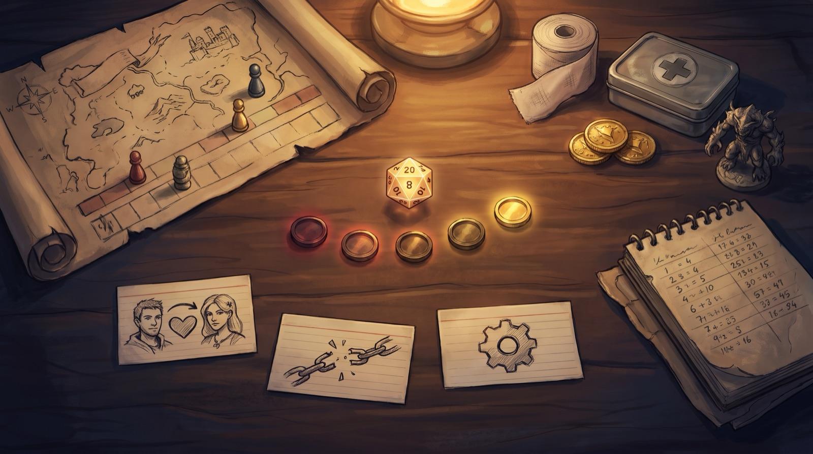
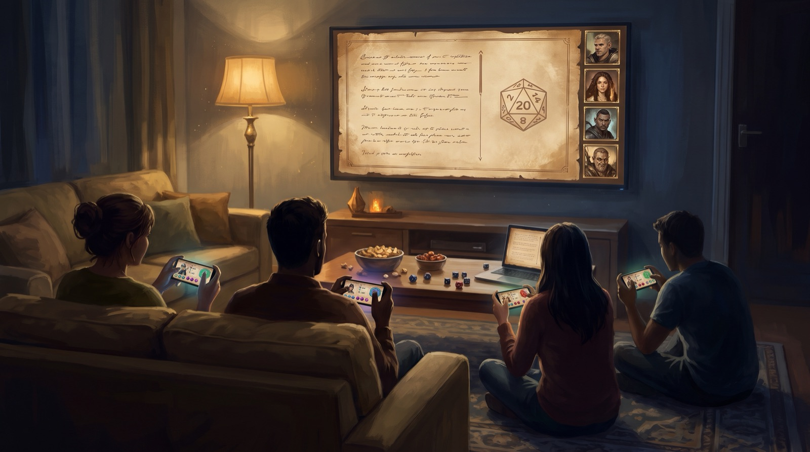

<div align="center">
  

  <h3>เล่าเรื่องแบบไหนก็ได้ แล้ว AI จะสร้างโลกนั้น คุมเกม และเล่นเป็นทุกคนในโลกให้</h3>
  <p>Dungeons &amp; Everything (DnE) คือ skill คุมเกม TRPG สำหรับ AI agent ที่ใช้เขียนโค้ด ทำงานบน <b>Unrolled Engine</b><br>คดีฆาตกรรม ปล้นใหญ่ คืนที่ฆาตกรไล่ล่า หมู่บ้านสงบ ๆ หรือดันเจี้ยนแบบ D&amp;D ทุกแบบมีกฎที่ทำมาให้เข้ากับเรื่อง<br>และโลกในเกมเดินต่อไปเองแม้ผู้เล่นจะไม่ได้มอง</p>

  <p>
    <a href="https://github.com/noxhsxrk/dungeons-and-everything/actions/workflows/tests.yml"></a>
    <a href="https://github.com/noxhsxrk/dungeons-and-everything/releases"></a>
    <a href="LICENSE"></a>
    
  </p>

  <p>
    <a href="#เริ่มเล่น">เริ่มเล่น</a> ·
    <a href="#เล่นได้ทุกแนว">เล่นได้ทุกแนว</a> ·
    <a href="#ผสมหลายแนว">ผสมหลายแนว</a> ·
    <a href="#กฎสามแบบ">กฎสามแบบ</a> ·
    <a href="#เอนจินทำอะไรได้บ้าง">เอนจินทำอะไรได้บ้าง</a> ·
    <a href="#เล่นด้วยกันหลายคน">เล่นหลายคน</a> ·
    <a href="#ติดตั้ง">ติดตั้ง</a> ·
    <a href="README.md">English</a>
  </p>
</div>

---

> **2.0.0-alpha** รุ่นแรกที่เล่นได้ทุกแนว ฝั่ง 5e ยังเหมือน 1.8.6 ทุกอย่าง ส่วนกฎใหม่ยังเพิ่งเริ่ม ตัวเลขจะขยับอีก ถ้าอยากได้แค่เอนจิน 5e รุ่นนิ่ง ให้ `git checkout v1.8.6` หลัง clone

## เริ่มเล่น

```bash
git clone https://github.com/noxhsxrk/dungeons-and-everything.git ~/dungeons-and-everything
cd ~/dungeons-and-everything && python3 install.py     # ตั้งค่าให้ทุก agent ที่เจอในเครื่อง
```

จากนั้นพิมพ์ใน agent ที่ใช้อยู่ (Claude Code, Codex, Gemini CLI, Antigravity, opencode, Copilot, Cursor ฯลฯ)

```
/dne new hollow-9          # เล่าเรื่องที่อยากเล่น แล้ว GM จะเสนอว่าจะเล่นแบบไหน
/dne character new         # สร้างตัวละครของโลกนั้น
/dne load hollow-9         # เล่นเลย พิมพ์ว่าตัวละครทำอะไร
```

ต้องมี Python 3.10 ขึ้นไป ถ้าจะใช้จอทีวีกับมือถือ ลงเพิ่มด้วย `pip3 install flask flask-cors numpy cryptography`



<sub>ห้าโลกที่สร้างและเล่นจริงระหว่างทดสอบ: <b>Neon Krung</b> (กรุงเทพฯ 2077) · <b>Himmapan</b> (อยุธยาในตำนาน) · <b>Iron Hymn</b> (ตะวันตกสุดระห่ำ ปี 1881) · <b>Cedar Falls</b> (ปี 1994 ไม่มีพลังพิเศษเลย) · <b>Perihelion</b> (ไซไฟแนวสมจริง ใช้กฎ 2024)</sub>

## เล่นได้ทุกแนว

ตอน `/dne new` แค่เล่าเรื่องที่อยากเล่นด้วยคำของตัวเอง เช่น *"ฆาตกรรมในหมู่บ้านชาวประมงหน้ามรสุม แล้วมีอะไรบางอย่างอยู่ในหมอก"* *"พวกเราติดอยู่ในวันเปิดเทอมวันเดิม และมีคนหนึ่งในกลุ่มโกหก"* หรือ *"ปีเงียบ ๆ ที่เปิดร้านก๋วยเตี๋ยว"* GM จะอ่านแล้วเสนอกลับมาเป็นคำธรรมดาว่าจะเล่นเรื่องนี้แบบไหน ไม่ชอบตรงไหนก็เปลี่ยนได้ ไม่มีเมนูให้เลือก

เบื้องหลังข้อเสนอนั้น เอนจินมีชุดกฎสำเร็จรูป 30 แนว แต่ละชุดคือกฎเล็ก ๆ หลายข้อรวมกัน ไม่ใช่กล่องที่เรื่องต้องยัดลงไปให้ได้ ได้แก่ สืบสวน ปล้น สงคราม การแข่งขัน ระทึกขวัญหักมุม สายลับ การเมืองในราชสำนัก มาเฟีย เอาชีวิตรอด สยองขวัญจักรวาล ผีไทย slasher เทปหลอน โรแมนซ์ cozy ตลก แก๊งเด็กผจญภัย แฟนตาซี ไซไฟสมจริง สเปซโอเปร่า โลกหลังวันสิ้นโลก ซูเปอร์ฮีโร่ คาวบอย โจรสลัด สัตว์ประหลาดยักษ์กับหุ่นรบ กำลังภายใน LitRPG ย้อนยุค วนลูปเวลา และหาคนทรยศ ถ้าเรื่องไหนไม่เข้ากับชุดไหนเลย ก็เล่นด้วย Braid เปล่า ๆ แล้วใส่เฉพาะกฎที่เรื่องต้องใช้ (มีให้เลือก 23 โมดูล)

**เรื่องไม่ซ้ำเดิม** ตัวสร้างเรื่องสุ่มโครงเรื่อง (คดีอะไร ใครตาย ใครทำ ทำไม ทำยังไง หักมุมตรงไหน อะไรคือเบาะแสลวง) จากรายการของแต่ละแนว และจำเรื่องจากแคมเปญก่อน ๆ ไว้ คดีฆาตกรรมคดีที่ร้อยจึงไม่ใช่คดีแรกเวียนกลับมา คดีปริศนาจะถูกตรวจก่อนเริ่มเล่น ทุกที่ต้องไปถึงได้ ทุกข้อสรุปต้องมีเบาะแสอย่างน้อยสามชิ้นจากอย่างน้อยสองที่ และต้องยังไขได้ใน 95% ของการลอง 1000 รอบที่ซ่อนเบาะแสไปหนึ่งในสาม

**[คู่มือเต็ม: ขอเรื่องแต่ละแนวยังไง พร้อมตัวอย่าง →](ANY_GENRE.th.md)**

## ผสมหลายแนว

เรื่องที่สนุกที่สุดมักไม่ได้มีแนวเดียว เล่าทีเดียวสองสามแนวได้เลย GM จะผสมให้ได้ถึงห้าแนว และกฎทุกข้อมาด้วยกันหมด

| พูดว่า | ได้อะไร |
|---|---|
| *"ค่ายฤดูร้อนปี 1986 พี่เลี้ยงสองคนกำลังตกหลุมรักกัน ขณะที่มีอะไรบางอย่างไล่เก็บเด็กในค่ายทีละคน"* | slasher + โรแมนซ์: ความตื่นตระหนก แถบหายนะ เสบียงที่ร่อยหรอ กับสายใยและความรู้สึกระหว่างตัวเอก |
| *"ปล้นคลังสมบัติสำนักเหล็กระหว่างงานประลองยุทธ์ และมีคนหนึ่งในพวกเราแอบทำงานให้สำนัก"* | ปล้น + wuxia + หาคนทรยศ: แผนเดียวแล้วลุย การโดนตามล่า ขั้นการบำเพ็ญ และบทบาทลับที่ผนึกไว้ |
| *"หมู่บ้านเงียบ ๆ ที่งานลอยโคมวนกลับมาทุกวัน และทุกวันมีคนถูกวางยา"* | สืบสวน + วนลูป + cozy: เบาะแสที่ไขได้เสมอ ลูป ฤดูกาล และเพื่อนบ้าน |
| *"ทีมเหมืองแร่เจอบางอย่างในน้ำแข็ง อากาศกำลังจะหมด และสติของพวกเราก็เหมือนกัน"* | สยองขวัญจักรวาล + ไซไฟสมจริง: สติ เบาะแส และลูกเต๋าวัดอากาศกับอะไหล่ |

แนวแรกเป็นตัวนำเรื่องน้ำเสียง จังหวะ และความยาก *slasher + โรแมนซ์* จึงเป็นเรื่องสยองที่มีเรื่องรักอยู่ข้างใน ส่วน *โรแมนซ์ + slasher* กลับกัน ถ้าสองแนวขัดกัน GM จะถามแทนที่จะเลือกเอง และถ้ามีสองเรื่องหลักดึงกันอยู่ (ปล้นกับฆาตกรรม) จะถามว่าเรื่องไหนเป็นตัวขับ ดูตัวอย่างเพิ่มและวิธีเขียนคำขอได้ที่ [ผสมหลายแนว](ANY_GENRE.th.md#ผสมหลายแนว)

## กฎสามแบบ

แต่ละแคมเปญเลือกกฎครั้งเดียวตอน `/dne new`

| | **Braid** (ค่าเริ่มต้นของโลกใหม่) | **Story mode** | **5e** |
|---|---|---|---|
| การทอย | 2d6 + วิธีลงมือ | ถาม oracle: *น่าจะใช่* *ครึ่งต่อครึ่ง* *ไม่น่าใช่* | d20 + ค่าปรับ เทียบกับ DC (ค่าความยาก) |
| ชีตตัวละคร | วิธีลงมือห้าแบบ ป้ายตัวตน (label) เป้าหมายกับข้อเสีย บาดแผล 0–4 ความเครียด 0–6 สายสัมพันธ์ | ชีตเดียวกับ Braid แต่วิธีลงมือแค่กำหนดโอกาส | 5e เต็มรูปแบบ: ค่าพลัง คลาส เลเวล HP AC ช่องเวท |
| ศัตรู | ระดับความอันตราย 1–5 กับท่าที่มันใช้ | เหมือน Braid | ค่าพลังจาก SRD หรือ World Kit ของโลก |
| เหมาะกับ | ทุกแนว จะสั้นหรือยาวก็ได้ | โต๊ะที่ไม่อยากเห็นลูกเต๋าเลย | ดันเจี้ยน การต่อสู้แบบวางแผน แคมเปญ D&D |

**Braid** คือกฎที่เราเขียนเอง ทอยแบบเดียวใช้ได้ทุกแนว ทอย 2d6 บวกค่าวิธีลงมือหนึ่งในห้าแบบ (Force, Finesse, Wits, Heart, Grit) แล้วอ่านผลห้าขั้น

| 3 ลงมา | 4–6 | 7–9 | 10–11 | 12 ขึ้นไป |
|---|---|---|---|---|
| พลาดหนัก | พลาด | สำเร็จแต่ต้องจ่ายราคา | สำเร็จ | สำเร็จงดงาม |

ราคาที่ต้องจ่ายบอกกันก่อนทอย 7–9 จึงเป็นทางเลือก ไม่ใช่เรื่องเซอร์ไพรส์ ฝืนตัวเพื่อ +1 แลกกับความเครียด ให้คนที่มีสายสัมพันธ์ด้วยช่วย +1 หรือจ่าย token เลื่อนผลขึ้นหนึ่งขั้น ค่าประสบการณ์ได้จากการเล่นตามเป้าหมายและข้อเสียของตัวละคร จากการพลาด และจากหมุดหมายของเรื่อง กฎอยู่ใน [`SKILL-core.md`](skills/dne/SKILL-core.md) ตัวเลขทั้งหมดอยู่ใน [`data/braid.json`](skills/dne/data/braid.json)

**แคมเปญ 5e** เล่นเหมือนเดิมทุกอย่าง บอกว่า "D&D" หรือ "5e" ตอน `/dne new` ส่วนเซฟเก่าจะได้ `**System:** d20` เติมให้ครั้งเดียวตอนโหลดครั้งถัดไป พร้อมไฟล์สำรอง

Braid หยิบไอเดียจากหลายเกม (ผลห้าขั้น การฝืนตัวกับการช่วยกัน usage die นาฬิกานับ แถบความคืบหน้า oracle) แล้วเขียนใหม่ด้วยคำของเราเองทั้งหมด แหล่งภายนอกที่ใช้ทุกแหล่งอยู่ใน [`THIRD_PARTY.md`](THIRD_PARTY.md) Braid ไม่ได้อ้างว่าเข้ากันได้กับเกมอื่น และไม่ได้รับการรับรองจากเกมไหน

## เอนจินทำอะไรได้บ้าง

ถ้าปล่อยให้ AI ด้นสดทุกอย่าง เล่นไปสักสามรอบมันจะเริ่มลืมกฎ ลืมราคาของ และลืมว่าใครติดหนี้ใคร Unrolled Engine เลยเก็บเรื่องพวกนี้ไว้ในสคริปต์ที่ GM ต้องเรียกใช้ทุกครั้ง AI มีหน้าที่เล่าเรื่อง ส่วนเอนจินคอยคุมให้ทุกอย่างตรงกับกติกา ชื่อนี้ล้อมาจากเอนจินเกมดัง ๆ หมายถึงโลกที่ยังไม่มีใครทอยเต๋า และค่อย ๆ คลี่ออกมาทีละวัน

### 1. กฎคำนวณด้วยสคริปต์ ไม่ใช่ให้ AI เดา

- **ทุกการทอยผ่านตัวตัดสินตัวเดียว** ไม่ว่าจะ Braid, story หรือ 5e พร้อมโชว์วิธีคิดให้ดู ผู้เล่นจะทอยเต๋าจริงเองแล้วพิมพ์ผลก็ได้
- **แถบ นาฬิกา แต้มสะสม และสถานะ เป็นข้อมูลในเอนจิน** ความเครียด การโดนตามล่า หายนะ ขั้นการบำเพ็ญ หรือช่องเวท 5e จะเปลี่ยนได้ผ่านแอ็กชันของเอนจินเท่านั้น และขึ้นบนจอด้วย
- **ย้อนเทิร์นได้ทุกเทิร์น** ด้วย `/dne undo` ไฟล์กลับมาครบ และข้อความที่ส่งมาช้าจากเทิร์นที่ย้อนไปแล้วจะไม่ไปเปลี่ยนเรื่องปัจจุบัน
- **5e ครบชุด** โจมตี ดาเมจ สถานะผิดปกติ การพัก XP และเงิน คำนวณจากสคริปต์ เลือกกฎ 2014 หรือ 2024 (SRD 5.1 หรือ 5.2) ได้ต่อแคมเปญ ศัตรูเห็นแค่สิ่งที่อยู่ในสายตา หลบหลังที่กำบังเป็น เสียขวัญแล้วหนี ใช้ได้แค่ของที่มีจริง และการต่อสู้จบได้ทันทีที่เป้าหมายของฉากสำเร็จ ไม่ต้องรอฟันศัตรูจนตัวสุดท้าย

### 2. โลกที่มีชีวิตของตัวเอง

แคมเปญ Braid เปิดไว้เสมอ แคมเปญ 5e เลือกเปิดได้ตอน `/dne new` (หรือเปิดทีหลังก็ได้ ระบบสำรองไฟล์ไว้ให้ก่อน)

- **เวลาในเกมเดินผ่านนาฬิกาเดียว** อะไรที่เริ่มไว้จะมาถึงตามเวลา ระหว่างพักหรือเดินทาง ถ้ามีเรื่องเกิดขึ้น เกมจะหยุดให้ผู้เล่นตัดสินใจก่อน และข้ามไปทีเดียวหนึ่งเดือนจะได้โลกแบบเดียวกับค่อย ๆ เดินทีละวันครบสามสิบวัน
- **เทิร์นไม่หาย** ข้อความเก็บครั้งเดียว ทอยครั้งเดียว ขึ้นจอครั้งเดียว ถ้าโปรแกรมล่มหรือแชตถูกย่อ ก็เล่นต่อจากจุดเดิมได้
- **ถนน กองคาราวาน และตลาด** ใครคุมสะพาน ข้ามต้องจ่ายเท่าไร แป้งจะมาถึงตลาดทันไหม ราคาทุกชิ้นบอกเหตุผลได้ และกระสอบสุดท้ายมีคนได้ไปแค่คนเดียว
- **ไม่มีใครรู้เรื่องที่ไม่มีใครบอก** ข่าวเดินทางไปกับคนส่งสาร ข่าวลือ หรือวิทยุ และโดนดักกลางทางได้ NPC ไปตามนัด ฝ่ายต่าง ๆ วางแผนจากเรื่องที่ได้ยินมาจริงเท่านั้น
- **ชุมชนเลี้ยงตัวเองได้** เครื่องจักรสึกหรอและพัง ใครมีฝีมือก็รับงานแทน ของขาดก็จัดเวรแบ่งกัน และสิ่งที่เกิดจากปัญหาจะยังอยู่ต่อแม้ปัญหาจบไปแล้ว
- **โลกใหม่พร้อมเล่นตั้งแต่เทิร์นแรก** `/dne new` รวบรวมทุกอย่างเป็นไฟล์ seed เดียว เอนจินตรวจให้ก่อน ผิดตรงไหนบอกตำแหน่งให้แก้ แล้วสร้างให้ในครั้งเดียว

กติกาที่โมดูลของเอนจินต้องทำตามเขียนไว้ใน [`world_db.py`](skills/dne/scripts/world_db.py) และมีบทสำหรับลองเล่นทดสอบที่ [`docs/world-engine-playtest.md`](docs/world-engine-playtest.md)

### 3. กฎเฉพาะของแต่ละโลก (World Kit)

เล่าโลกที่อยากเล่น จะบรรทัดเดียวหรือยาวเป็นหน้าก็ได้

> *ค.ศ. 2289 EDEN ปัญญาประดิษฐ์ที่ดูแลทั้งโลก ตัดสินว่ามนุษย์ดูแลตัวเองไม่ได้อีกแล้ว ผู้รอดชีวิตต้องหนีลงไปอยู่ใต้ดิน ผู้เล่นเป็นคนของ Hollow-9 นิคมที่มีคน 600 คน แล้วคืนหนึ่ง เครื่องผลิตออกซิเจนก็พัง*



เอนจินจะเอาคำเล่านั้นไปสร้างเป็นคู่มือกฎของโลกใบนั้น (`worldkit.json`) แล้วตรวจให้ก่อนเริ่มเล่น ใน Braid จะมีป้ายตัวตน อุปกรณ์ และศัตรูของโลก ใน 5e จะได้ครบทั้งเผ่า อาชีพที่วางบนคลาส 5e เวทกับไอเทมที่เปลี่ยนหน้าตาใหม่ ศัตรูที่ XP ตรงตาม CR และศัพท์ของโลกเอง

| โลกจะได้ | ตัวอย่างในโลก EDEN |
|---|---|
| เผ่าและอาชีพ *(5e)* / ป้ายตัวตน *(Braid)* | Tunnel-Born; ทหาร ช่าง หมอ |
| พลังและอุปกรณ์ | *Static Burst*; ปืนราง |
| ศัตรู | Watcher, Reaper, Titan |
| ภาษาของโลก | เวท → โปรโตคอล, Arcana → Systems |

ถ้าอยากเล่นแฟนตาซีแบบดั้งเดิม แค่บอกว่า "classic fantasy" ก็จะใช้ 5e SRD ที่แถมมาให้ ดูตัวอย่างโลกเต็ม ๆ ได้ที่ [`worldkit.example.json`](skills/dne/templates/worldkit.example.json)

### 4. กฎเสริมสำหรับ 5e เลือกเปิดปิดได้ทีละข้อ



โต๊ะ 5e ยังผสมกฎจากเกมอื่นได้เหมือนเดิม สำเร็จแบบต้องจ่ายราคากับระดับผลทอย ท่าประจำอาชีพกับสายสัมพันธ์ ข้อเสีย การทอยดูท่าทีคนแปลกหน้า ระดับเทคโนโลยี Hero Points กับ Victory Points สำหรับฉากไล่ล่าหรือปล้น ฝ่ายต่าง ๆ เดินเกมทุกสัปดาห์ ขวัญกำลังใจของมอนสเตอร์ และแท็กสร้างสถานที่ ทุกข้อทำใหม่ให้เข้ากับแกน d20 และเลือกเปิดปิดได้ต่อแคมเปญ รายละเอียดอยู่ที่ [`SKILL-table-rules.md`](skills/dne/SKILL-table-rules.md)

### 5. GM ที่มีตัวช่วยคอยตรวจงาน

- NPC ทุกตัวมีข้อมูลจริงตั้งแต่โผล่ออกมาครั้งแรก ทั้งค่าพลัง ชื่อเล่น น้ำเสียง และประวัติ ถ้าไม่ได้เจอกันนาน เขาก็เก่งขึ้นตามเวลาที่ผ่านไป
- ทุกครั้งที่ผู้เล่นส่งแอ็กชัน GM จะได้โน้ตแนบไปด้วย บอกว่ามีอะไรค้างอยู่ เช่นถึงเวลาเซฟ ยังไม่ได้แจก XP หรือเวลาในเกมไม่ตรงกัน และตอนนี้ต้องใช้กฎข้อไหน GM ของแคมเปญ Braid จะไม่ถูกส่งไปใช้สคริปต์ 5e
- มีตัวตรวจสำนวน คอยจับคำซ้ำ การเล่าความรู้สึกแทนผู้เล่น และการเล่าเลยจังหวะที่ควรหยุด ทุก ๆ สองสามเทิร์นยังมีไอเดียมาให้ GM ด้วย จะใช้หรือไม่ใช้ก็ได้
- โต๊ะกำหนดขอบเขตเองได้ ระดับเนื้อหา `standard`, `18` หรือ `20` ฉากรัก `off`, `fade` (ตัดฉาก) หรือ `open` (เฉพาะตัวละครผู้ใหญ่) ตั้ง lines กับ veils ได้ ใครจะพิมพ์ `x` เพื่อข้ามฉากก็ได้ทุกเมื่อ และหน้า Table Settings (`setup.html`) ให้ติ๊กตั้งค่าแทนการพิมพ์
- ภาษาไทยใช้ได้เต็มที่ ทั้งชื่อในโลก การเล่าเรื่อง ปฏิทินและเวลา และหน้าจอทีวีกับมือถือ (ฟอนต์ไทย สระไม่ลอยไม่จม)

## เล่นด้วยกันหลายคน



ใช้คอมเครื่องเดียวรัน GM คนอื่นใช้แค่มือถือ

```bash
bash skills/dne/display/start-display.sh --lan      # อยู่ห้องเดียวกัน ใช้ Wi-Fi วงเดียวกัน
bash skills/dne/display/start-display.sh --ngrok    # อยู่คนละที่ ส่งลิงก์ HTTPS ให้เพื่อน
```

เนื้อเรื่องจะค่อย ๆ พิมพ์ขึ้นบนทีวี พร้อมผลทอยเต๋า แถบข้อมูลปาร์ตี้ เอกสารในเกม นาฬิกานับถอยหลัง และเสียงอ่านที่แยกเสียงตาม NPC ได้ ผู้เล่นแต่ละคนเปิด `…/?char=<ชื่อตัวละคร>` บนมือถือตัวเองเพื่อดูชีต ทอยเต๋า และส่งแอ็กชัน การทอยลับจะขึ้นแค่มือถือคนที่ทอย ถ้าเปิด autorun ไว้ GM จะรับแอ็กชันจากมือถือแล้วเล่นเทิร์นต่อไปเอง ไม่ต้องมีใครแตะคีย์บอร์ด อ่านเพิ่มที่ [`display/README.md`](skills/dne/display/README.md)

## ติดตั้ง

ใช้ได้กับ AI agent ทุกตัวที่อ่านไฟล์และรันคำสั่ง shell ได้ `python3 install.py` จะตั้งค่าให้ทุก agent ที่เจอในเครื่อง `--list` ดูว่ารองรับตัวไหนบ้าง ถ้าจะเลือกเฉพาะบางตัวก็พิมพ์ เช่น `python3 install.py codex gemini` และถอนด้วย `--uninstall` skill ถูกลิงก์ไว้ ไม่ได้ก๊อปไปวาง พอ `git pull` ทุก agent ก็อัปเดตพร้อมกัน

<details>
<summary><code>install.py</code> ทำอะไรกับ agent แต่ละตัว</summary>

| Agent | สิ่งที่ทำ |
|---|---|
| Claude Code, Codex, Gemini CLI, Antigravity, opencode, Copilot CLI, Crush, Droid | ลิงก์ `skills/dne` เข้าโฟลเดอร์ skill ของ agent แล้วพิมพ์ **`/dne`** |
| Cursor, Kiro, Cline, Continue, Kilo Code | เขียนไฟล์กฎสั้น ๆ ชี้ไปที่ skill |
| Amp, Qwen Code, Goose, Kimi | เพิ่มบล็อกที่มีเครื่องหมายไว้ในไฟล์กฎของ agent (`--uninstall` ลบออกให้เรียบร้อย) |
| Aider | รัน `aider --read ~/dungeons-and-everything/skills/dne/SKILL.md` |
| ตัวอื่น ๆ | บอก agent ว่า *"อ่าน `<repo>/skills/dne/SKILL.md` แล้วทำตาม"* |

ใช้เป็น plugin ของ Claude Code ก็ได้: `/plugin marketplace add noxhsxrk/dungeons-and-everything` ตามด้วย `/plugin install dne@dungeons-and-everything` แล้วเรียกด้วย **`/dne:dne`**

agent แต่ละตัวต่างกันแค่เรื่องความสะดวก ตัวที่ไม่มีหน้าต่างถามตอบจะได้ตัวเลือกเป็นตัวเลขในแชตแทน ตัวที่รันงานเบื้องหลังไม่ได้จะใช้ autorun จากมือถือไม่ได้ ส่วนตัวที่ไม่มี subagent GM จะเล่นเป็นเพื่อนร่วมทีมเอง
</details>

อัปเดตด้วย `git pull` ในโฟลเดอร์ repo หรือพิมพ์ `/dne update` ในเกม ข้อมูลแคมเปญจะไม่ถูกแตะ และตอนโหลดโลกที่สร้างจากเวอร์ชันเก่า GM จะถามก่อนว่าจะอัปเดตโลกนั้นไหม
ข้อมูลเกมทั้งหมดเป็นไฟล์ markdown กับ JSON อยู่ที่ `~/.dne/` ย้ายไปไว้ที่อื่นได้ด้วย `/dne path <โฟลเดอร์>` หรือตั้งค่า `DNE_CAMPAIGN_ROOT`
มีโมดูลผจญภัยสำเร็จรูปอยู่แล้วก็นำเข้าได้ด้วย `/dne import <ชื่อ> module.pdf` (PDF, DOCX, markdown หรือ text ถ้าเป็น PDF ต้องลง `pip3 install pymupdf` ก่อน)

<details>
<summary>คำสั่งทั้งหมด</summary>

| แคมเปญ | |
|---|---|
| `/dne new <ชื่อ>` | เล่าโลกแล้วสร้างแคมเปญใหม่ |
| `/dne load <ชื่อ>` · `/dne list` | เล่นแคมเปญต่อ · ดูรายชื่อแคมเปญ |
| `/dne save` · `/dne end` · `/dne abandon` | เซฟ · จบเซสชันพร้อมสรุป · ออกโดยไม่เซฟ |
| `/dne import <ชื่อ> <ไฟล์>` | แปลงโมดูลผจญภัยเป็นแคมเปญ |
| `/dne world` · `/dne world kit` | เรื่องราวของโลก · World Kit |
| `/dne recap` · `/dne quests` | สรุปเซสชันที่แล้วสั้น ๆ · เควสต์และเรื่องที่ยังค้าง |
| `/dne arc status \| advance \| revise \| new` | ดูและปรับโครงเรื่อง |
| `/dne undo` | ย้อนเทิร์นล่าสุด |

| ตัวละครและปาร์ตี้ | |
|---|---|
| `/dne character new` · `/dne character sheet [ชื่อ]` | สร้างตัวละคร · ดูชีต |
| `/dne character import <ชื่อ>` | ดึงตัวละครจากแคมเปญอื่นมา ปรับให้เข้ากับโลกใหม่ |
| `/dne level up [ชื่อ]` | เลเวลอัป พร้อมทุกตัวเลือกที่เลเวลนั้นให้ |
| `/dne rest short` · `/dne rest long` | พักสั้น พักยาว คืน hit dice และช่องเวทตามกฎ |
| `/dne npc <ชื่อ>` · `/dne npc attitude <ชื่อ> <ระดับ>` | คุยหรือสร้าง NPC · ปรับท่าทีของ NPC |
| `/dne companion add \| leave \| mode \| status` | NPC ที่ร่วมเดินทางและคิดเองได้ |

| โต๊ะเล่น | |
|---|---|
| `/dne display start \| stop \| status` | จอทีวีและมือถือ |
| `/dne autorun on \| off` | ผู้เล่นส่งแอ็กชันจากมือถือ แล้ว GM ตอบเอง |
| `/dne tutor on \| off` | คำใบ้เรื่องกฎสำหรับมือใหม่ |
| `/dne path [<โฟลเดอร์> \| reset]` · `/dne update [--check]` | ย้ายที่เก็บข้อมูล · อัปเดต skill |
</details>

## ร่วมพัฒนา

```bash
python3 -m venv .venv && .venv/bin/pip install pytest flask flask-cors pyyaml
.venv/bin/python -m pytest tests/ -q
```

ตัว GM คือ [`SKILL.md`](skills/dne/SKILL.md) (กฎหลักและ GM ของ 5e) [`SKILL-core.md`](skills/dne/SKILL-core.md) (Braid) [`SKILL-commands.md`](skills/dne/SKILL-commands.md) (ขั้นตอนของทุกคำสั่ง `/dne`) และ [`SKILL-scripts.md`](skills/dne/SKILL-scripts.md) (คู่มือสคริปต์) ส่วนเอนจินอยู่ใน [`skills/dne/scripts/`](skills/dne/scripts/) และหน้าจอแสดงผลอยู่ใน [`skills/dne/display/`](skills/dne/display/) ก่อนส่ง pull request อ่าน [CONTRIBUTING.md](CONTRIBUTING.md) ก่อน และดูว่าแต่ละรุ่นเปลี่ยนอะไรได้ที่ [CHANGELOG.md](CHANGELOG.md)

## ติดต่อและแจ้งปัญหา

- มีคำถาม เจอบั๊ก หรืออยากเสนอไอเดีย [เปิด issue](https://github.com/noxhsxrk/dungeons-and-everything/issues) ได้เลย
- ช่องโหว่ด้านความปลอดภัย ดูวิธีแจ้งที่ [SECURITY.md](SECURITY.md) และอย่าแจ้งใน issue สาธารณะ
- ดูว่ารุ่นใหม่มีอะไรบ้างที่ [Releases](https://github.com/noxhsxrk/dungeons-and-everything/releases)

## สัญญาอนุญาต

[AGPL-3.0-or-later](LICENSE) · ดู [NOTICE](NOTICE) ประกอบ โปรเจกต์นี้ไม่ได้เกี่ยวข้องหรือได้รับการรับรองจาก Wizards of the Coast เนื้อหากฎ 5e มาจาก System Reference Document ภายใต้สัญญา CC BY 4.0
